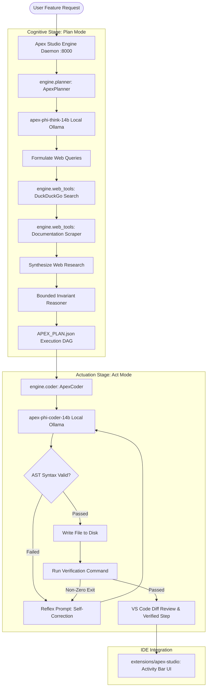

# Apex Studio: Cognitive Invariant AI IDE

[](LICENSE.txt)
[](https://huggingface.co/nileshc90/apex-phi-14b)
[](https://github.com/nileshchakraborty/apex-studio)

**Apex Studio** is a next-generation open-source AI IDE built on top of the Microsoft VS Code (`Code - OSS`) architecture. It decouples software engineering into a **two-stage cognitive pipeline**:
1. **Plan (Cognitive Architecture & Autonomous Web Exploration)**: Powered by `apex-phi-think-14b`, which queries DuckDuckGo, scrapes official documentation and APIs, synthesizes mathematical invariant constraints, and generates an ordered execution DAG (`APEX_PLAN.json`).
2. **Act (Deterministic Code Actuation & Verification)**: Powered by `apex-phi-coder-14b`, which writes production-grade code, enforces AST syntax validation, executes step-specific verification commands, and runs reflexive self-repair loops upon any test failures.

---

## 🏛️ System Architecture



---

## 🚀 Quickstart

### 1. Prerequisites
- **Ollama** running locally with `apex-phi-think-14b` and `apex-phi-coder-14b`:
  ```bash
  ollama list
  # Confirm apex-phi-think-14b and apex-phi-coder-14b are present
  ```
- **Python 3.10+** with dependencies:
  ```bash
  pip install ddgs beautifulsoup4 fastapi uvicorn requests pydantic
  ```
- **Node.js 18+** & `npm`

### 2. Setup Apex Studio
Run the automated bootstrap script:
```bash
./scripts/setup_apex_studio.sh
```

### 3. Launching Apex Studio
Launch the engine daemon and the IDE:
```bash
./scripts/apex-studio.sh
```
Or start the engine daemon independently:
```bash
python3 -m engine.server
```

---

## 🔄 Multi-Model Switching

Apex Studio supports switching dynamically between any installed models in Ollama:

| Suite | Planner (Cognition & Web) | Actuator (Deterministic Code) | Architecture |
|---|---|---|---|
| **Phi Suite (14B)** | `apex-phi-think-14b` | `apex-phi-coder-14b` | Microsoft Phi-4 fine-tuned |
| **Mistral Suite (22B)** | `apex-mistral-think-22b` | `apex-mistral-coder-22b` | Mistral NeMo 22B |
| **Qwen Suite (14B)** | `apex-think-14b` | `apex-coder-14b` | Qwen-2.5 14B with CID distillation |
| **Custom Pairings** | Any Ollama model (e.g. `deepseek-r1:14b`) | Any Ollama model (e.g. `codestral`) | User selected |

### Switching via VS Code / Cursor:
- **Sidebar Header**: Click on the preset suite pills (`Phi-14B`, `Mistral-22B`, `Qwen-14B`) or use the dropdown selectors.
- **Command Palette**: Run `Apex Studio: Switch Model Suite / Active Models` to switch suites or select custom models.

### Switching via CLI:
```bash
# View all installed models & active selections
python3 -m engine.cli models

# Switch to a preset suite
python3 -m engine.cli set-model --suite mistral
python3 -m engine.cli set-model --suite qwen
python3 -m engine.cli set-model --suite phi

# Custom pairing
python3 -m engine.cli set-model --think deepseek-r1:14b --coder codestral

# On-the-fly override during planning or execution
python3 -m engine.cli plan "Feature..." --think-model apex-mistral-think-22b
python3 -m engine.cli act --step 1 --coder-model apex-mistral-coder-22b
```

---

## 🖥️ VS Code / Cursor Extension

Apex Studio includes a dedicated extension located in `extensions/apex-studio`.

### Installation in VS Code / Cursor
```bash
code --install-extension apex-studio.vsix
# or for Cursor:
cursor --install-extension apex-studio.vsix
```

### Features
- **Model Switcher**: Direct suite pills and dropdown selectors to toggle between `Phi-14B`, `Mistral-22B`, `Qwen-14B`, or custom models.
- **Sidebar Activity Container**: Direct access to Apex Studio in the VS Code Activity Bar.
- **Plan Tab**: Input feature specifications, toggle live DuckDuckGo web research, view real-time cognitive reasoning traces, and preview the generated invariant step DAG.
- **Act Tab**: Step-by-step progress tracking, one-click execution of planned steps with AST validation, live unified diff reviews, and terminal verification feedback.
- **Direct Editor Navigation**: Click on any target file in the plan to open it directly in the editor.

---

## ⌨️ Command Line Interface (CLI)

You can use the full cognitive pipeline directly from the command line:

```bash
# Check status of models and daemon
python3 -m engine.cli status

# View available models and preset suites
python3 -m engine.cli models

# Switch default model suite
python3 -m engine.cli set-model --suite mistral

# Search web for library documentation
python3 -m engine.cli search "fastapi lifespan asynccontextmanager"

# Plan a feature using chosen thinking model with autonomous web search
python3 -m engine.cli plan "Add rate-limiting middleware using Redis token-bucket"

# Execute a single step from APEX_PLAN.json
python3 -m engine.cli act --step 1

# Execute all steps sequentially with verification
python3 -m engine.cli act --all

# Launch the FastAPI engine daemon
python3 -m engine.cli serve
```

---

## 🔌 Engine API Endpoints

The Apex Studio backend daemon runs on `http://127.0.0.1:8000`:

| Endpoint | Method | Description |
|---|---|---|
| `/api/status` | `GET` | Health check, connected models, active plan status |
| `/api/models` | `GET` | List all Ollama models, recommendations, and preset suites |
| `/api/models/select` | `POST` | Switch active think and/or coder model |
| `/api/search` | `POST` | DuckDuckGo search query execution |
| `/api/scrape` | `POST` | Webpage scraper and markdown extractor |
| `/api/plan` | `POST` | Synthesize feature plan with active thinking model |
| `/api/plan/current` | `GET` | Retrieve the active plan DAG (`APEX_PLAN.json`) |
| `/api/execute-step` | `POST` | Execute step with active coder model |
| `/api/execute-all` | `POST` | Sequentially execute all pending steps |
| `/api/plan/reset` | `POST` | Clear active plan |

---

## 📄 License
This project is licensed under the MIT License - see the [LICENSE.txt](LICENSE.txt) file for details.
